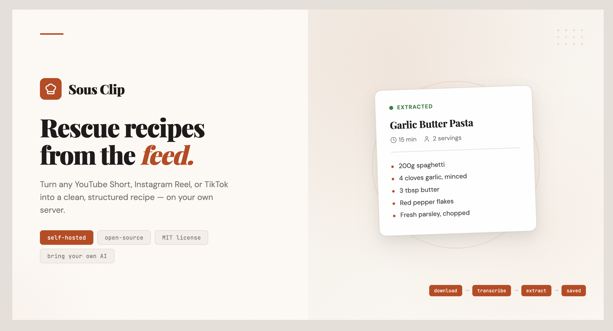
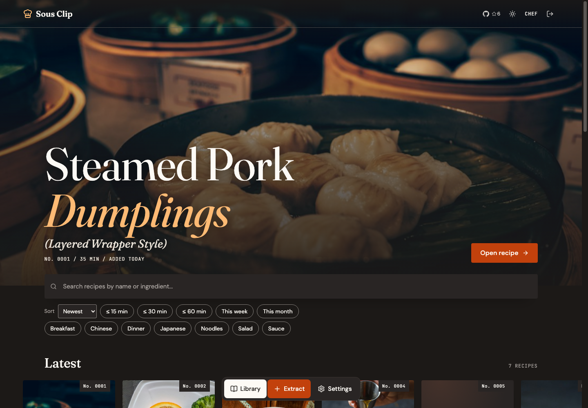
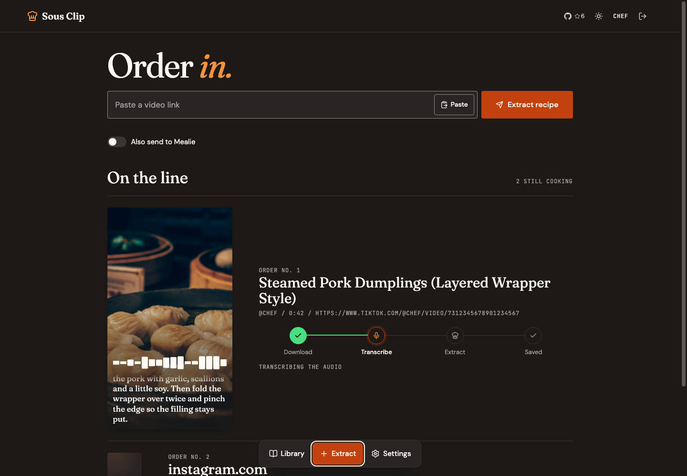
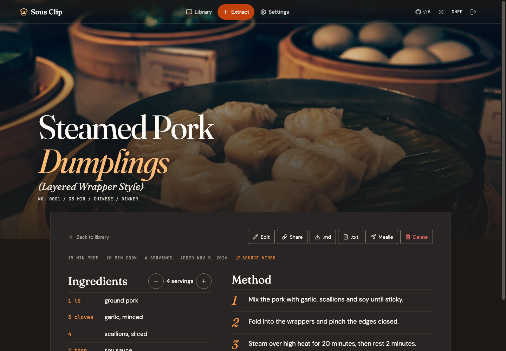

# Sous Clip

<p align="center">
  
</p>

> Your recipes. Your server. Forever.

[](LICENSE)
[](docker-compose.yml)

You see a great recipe in a short video. They rattle off ingredients and timings, and you end up pausing and rewatching to write it down. Most recipe apps save it on their server, behind their paywall. **Sous Clip** is a self-hosted, privacy-first recipe extractor for the short-form video era: paste a link, get a clean recipe, keep it on your own server.

Transcription runs locally. For the recipe step you choose the AI: Claude, OpenAI, or a model running on your own hardware.

<p align="center">
  
</p>

<p align="center">
  
  
</p>

## Features

- **Any short-form video**: YouTube Shorts, Instagram Reels and TikTok via yt-dlp (long-form is untested)
- **Local transcription**: Whisper runs on your server (GPU or CPU, auto-detected), with live captions while it transcribes
- **Your AI, your key**: Claude, OpenAI, Ollama, or any OpenAI- or Anthropic-compatible endpoint
- **Recipe library**: search, filter by time and tag, scale servings, edit, share a public link, export `.md` or `.txt`
- **Mobile share sheet**: install as a PWA and share links straight from other apps (Android; on iOS paste the link)
- **Mealie**: optionally forward recipes to your [Mealie](https://mealie.io/) instance
- **Yours**: recipes live in one SQLite file on your server

## Quick Start

```bash
git clone https://github.com/SachinVenugopalan30/sous-clip.git
cd sous-clip
cp .env.example .env
# Edit .env: set APP_PASSWORD, JWT_SECRET and your AI key

# Download the Whisper model (one-time setup)
python scripts/download-model.py

# Start everything (pulls the prebuilt image; use `up -d --build` to build locally)
docker compose pull
docker compose up -d
```

Open **http://localhost:3000**

> **Whisper model download notes:**
>
> The script needs Python 3 and makes a temporary venv to install `huggingface_hub`. If it fails, install `python3-venv`:
>
> ```bash
> # Debian/Ubuntu — required if you see "No module named pip" or "externally-managed-environment"
> sudo apt install python3-venv
> ```
>
> To download a different model size: `python3 scripts/download-model.py medium`
>
> For faster downloads, add a free [Hugging Face token](https://huggingface.co/settings/tokens) as `HF_TOKEN=hf_...` in your `.env` before running the script.

## AI Providers

| Provider | Default model | Key |
|---|---|---|
| Anthropic | claude-sonnet-4-6 | Yes |
| OpenAI | gpt-4o | Yes |
| Ollama | any local model | No |
| Custom endpoint | any | Optional |

Set the provider in `.env` or under **Settings**. A custom endpoint can be anything OpenAI- or Anthropic-compatible (LM Studio, vLLM, a proxy); **Test connection** detects which. OpenAI-style endpoints are asked for JSON matching a schema, falling back to plain JSON mode. Small local models can still get details wrong, so check their recipes.

## Architecture

```
URL -> yt-dlp -> faster-whisper -> AI -> SQLite
        Temporal workflow runs each step
```

- **Backend:** Python 3.14, FastAPI, uv
- **Frontend:** React 19, Vite 8, TypeScript 7, TanStack Router, Tailwind 4, Bun
- **Queue:** Temporal 1.32 (on Postgres 18) and Valkey 9
- **Database:** SQLite, one file, no setup
- **Observability:** OpenTelemetry (opt-in)

## Mealie (optional)

1. In Mealie, open **User Profile -> API Tokens** and create a token.
2. In Sous Clip, open **Settings -> Mealie**, enter the URL and token, and click **Test connection**.
3. Turn on **Also send to Mealie** when extracting, or send a saved recipe from its page.

If forwarding fails the recipe is still saved, and the error shows in the queue.

## Updating

Upgrading from 1.x? Read [Upgrading to 2.0](docs/upgrading-to-v2.md) first; it needs one extra step.

```bash
docker compose pull && docker compose up -d
```

Sous Clip checks GitHub once an hour and shows a notice when a release is out (turn it off in **Settings -> Updates**). The `:latest` image is also rebuilt weekly so yt-dlp stays current.

**Update from the app (optional):** add these to `.env`, then `docker compose up -d`:

```env
WATCHTOWER_HTTP_API_TOKEN=<any random string>
COMPOSE_PROFILES=updater
```

This starts a [Watchtower](https://github.com/nicholas-fedor/watchtower) container, and **Settings -> Updates** gets an **Update** button that pulls the new image and restarts the app. Watchtower needs the Docker socket, which is root-equivalent on the host, so it only runs when you opt in, and it only touches the `app` and `worker` containers. Podman users also set `DOCKER_SOCKET=/run/user/$UID/podman/podman.sock` (best-effort).

## Podman

The compose file works with Podman as-is:

```bash
podman compose up -d   # needs podman-compose >= 1.1, or docker-compose as the provider
```

- **GPU:** set up the NVIDIA CDI spec (`sudo nvidia-ctk cdi generate --output=/etc/cdi/nvidia.yaml`), then use `devices: [nvidia.com/gpu=all]` on the `worker` service instead of the `deploy:` block.
- **Ollama on the host:** use `http://host.containers.internal:11434` as the Ollama URL.

## GPU

The image runs on CPU. For NVIDIA GPU, uncomment the `deploy:` block on the `worker` service in `docker-compose.yml`. The container also needs the CUDA libraries (cuBLAS and cuDNN); `WHISPER_DEVICE=auto` only picks the GPU when it finds them, otherwise CPU. See [Configuration](docs/configuration.md#whisper-transcription).

## Documentation

- [Configuration Guide](docs/configuration.md)
- [Upgrading to 2.0](docs/upgrading-to-v2.md)
- [Reverse Proxy Setup](docs/reverse-proxy.md)
- [PWA Installation](docs/pwa.md)
- [Contributing](CONTRIBUTING.md)

## License

MIT
